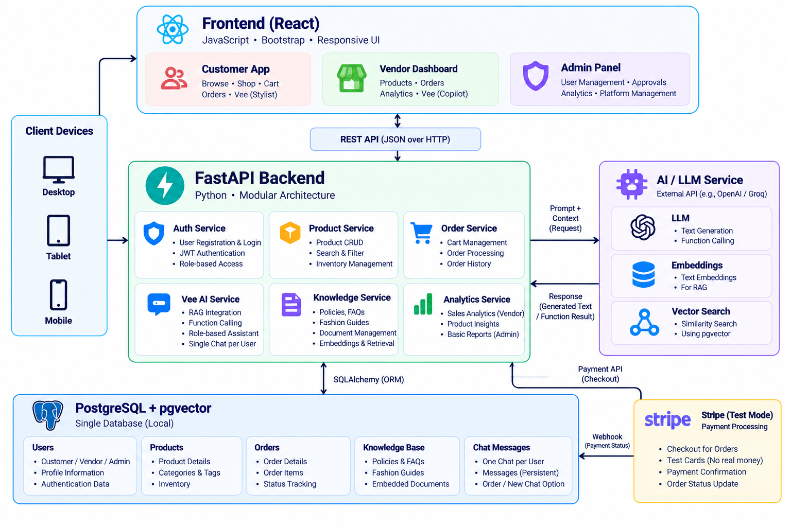

# Vestra — AI-Powered Fashion Marketplace

Vestra is an AI-powered fashion marketplace that brings together curated fashion collections, personalized shopping, and intelligent product discovery in one unified platform. It features **Vee**, an AI fashion stylist that provides personalized outfit recommendations, real-time product information, and shopping assistance.

The platform combines modern e-commerce functionality with **Retrieval-Augmented Generation (RAG)** and **function calling** to deliver context-aware assistance grounded in relevant knowledge and live application data.

Product listings, inventory, pricing, categories, and featured collections are managed centrally through an administrator dashboard, while customers can browse products, manage their carts, and place orders.

**Project Status:** In Development

---

## Table of Contents

- [Architecture](#architecture)
- [Features](#features)
- [AI Assistant — Vee](#ai-assistant--vee)
- [Technology Stack](#technology-stack)
- [Project Structure](#project-structure)
- [Getting Started](#getting-started)
- [Environment Configuration](#environment-configuration)

---

## Architecture



Vestra follows a modular architecture with separate frontend and backend applications. PostgreSQL provides persistent data storage, while pgvector supports semantic retrieval for AI-powered features.

The AI layer combines knowledge retrieval with authorized backend tools to support customer shopping experiences and vendor workflows.

---

## Features
### Marketplace

- **Curated Product Catalog:** Browse fashion products across clothing, shoes, and accessories.
- **Product Management:** Admin-managed product listings, inventory, search, filtering, and pagination.
- **Shopping Cart:** Add products, update quantities, and manage selected items before checkout.
- **Order Management:** Place orders, track order status, and view purchase history.
- **Payment Integration:** Stripe Checkout integration planned for test-mode payment flows.
- **Role-Based Access Control:** Separate customer and administrator permissions.

### Admin Dashboard

- Add, edit, and remove products.
- Manage product images, categories, sizes, colours, prices, and stock.
- Manage orders and customer accounts.
- Control featured products, new arrivals, and homepage collections.
- View sales and inventory insights.

### AI Implementation

Vee combines two complementary techniques:

- **Retrieval-Augmented Generation (RAG):** Retrieves relevant information from product descriptions, fashion guides, FAQs, and platform policies.
- **Function Calling:** Uses authorized backend tools to retrieve current product prices and availability, discover products, and support permitted shopping actions.

The backend validates requests and enforces authorization before accessing protected resources or performing actions.

### Conversation Management

- Persistent conversations across sessions.
- Start a new conversation or clear existing history.
- Context-aware responses based on relevant conversation history.
---

## Technology Stack

| Component | Technology |
|---|---|
| Frontend | React, JavaScript |
| UI & Styling | Bootstrap |
| Build Tool | Vite |
| Backend | Python, FastAPI |
| Database | PostgreSQL |
| ORM | SQLAlchemy 2.0 |
| Database Migrations | Alembic |
| Vector Search | pgvector |
| Data Validation | Pydantic |
| Authentication | JWT, password hashing |
| AI Integration | LLM APIs, embeddings, RAG, function calling |
| Payments | Stripe Checkout (test mode) |
| Testing | Pytest, HTTPX |

---

## Project Structure

```text
vestra/
├── vestra-backend/
├── vestra-frontend/
├── files/
│   └── Architecture.png
├── .env.example
├── .gitignore
└── README.md
```

The repository contains separate application modules for the frontend and backend. Architecture diagrams and technical documentation are maintained in the `docs/` directory.

---

## Getting Started

### Prerequisites

- Python 3.11 or another compatible version.
- Node.js and npm.
- PostgreSQL with the pgvector extension.
- Git.
- API credentials for the selected AI provider.
- Stripe test-mode credentials when implementing the payment integration.

### 1. Clone the Repository

```bash
git clone https://github.com/YOUR_USERNAME/vestra.git
cd vestra
```

Replace `YOUR_USERNAME` with the repository owner's GitHub username.

### 2. Configure the Backend

Navigate to `vestra-backend/` and follow its setup instructions.

Create and activate a Python virtual environment, install the project dependencies, and configure the required environment variables.

### 3. Configure the Database

Create a PostgreSQL database, enable the pgvector extension, configure the database connection, and apply the available Alembic migrations.

### 4. Configure the Frontend

Navigate to `vestra-frontend/`, install the npm dependencies, and configure the frontend environment variables.

### 5. Start the Applications

Follow the backend and frontend startup instructions provided in their respective directories.

> Detailed installation and execution instructions will be documented as the application modules are implemented.

---

## Environment Configuration

Create a local environment configuration using `.env.example` as a reference.

Depending on the implemented features, the application may require configuration for:

- Database connectivity.
- Authentication and application secrets.
- AI provider and embedding model credentials.
- Frontend API base URL.
- Stripe test-mode credentials.

Keep actual credentials in local environment files and ensure they are excluded from version control.


---

**Vestra** — Discover your style. Empower your store. Shop smarter.